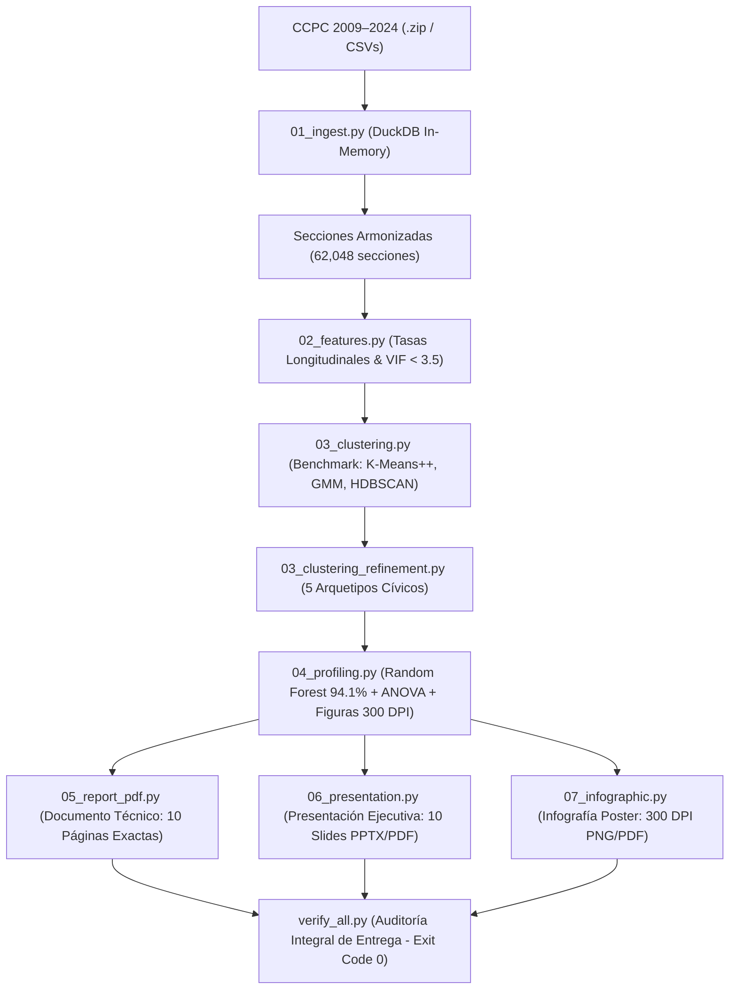

# Reto 1: Perfiles Ciudadanos de Participación
## Concurso "Hackea la Participación: Datos que construyen democracia"
### CCPC 2009–2024 / ENCÍVICA — Instituto Nacional Electoral (INE)

---

## 1. Metadatos Oficiales del Proyecto

- **Convocatoria Oficial:** Concurso *"Hackea la Participación: Datos que construyen democracia"* (CCPC 2009–2024 / ENCÍVICA)[cite: 1].
- **Reto:** Reto 1: Perfiles ciudadanos de participación[cite: 1].
- **Nombre del Equipo:** `Byte me`
- **Representante:** `Johanan Olivares Gutierrez`
- **Integrantes y Roles:**
  1. **Johanan Olivares Gutierrez** (Representante) — *Científico de Datos Principal / Ingeniero de MLOps*
  2. **Oscar Ariel Cuevas Martinez** — *Investigador en Modelación Social Computacional*
  3. **Saul Alexis Arias Gonzales** — *Diseñador de Información para Políticas Públicas*

*(Nota: Las cartas de cesión de derechos y declaratorias bajo protesta de decir verdad se gestionan por canales externos conforme a bases).*

---

## 2. Resumen Ejecutivo y Hallazgos Centrales

Este repositorio contiene la solución matemática, algorítmica y de diseño de políticas públicas desarrollada por el equipo **Byte me** para el Reto 1 del concurso convocado por el Instituto Nacional Electoral (INE)[cite: 1, 4].

A partir de la ingesta en memoria con DuckDB de las bases de datos de los Conteos Censales de Participación Ciudadana (CCPC) de **seis elecciones federales consecutivas (2009, 2012, 2015, 2018, 2021 y 2024)**, el equipo armonizó una cartografía longitudinal de **62,048 secciones electorales continuas**, cubriendo a **85,936,860 electores** en Lista Nominal y el **99.11% de los municipios** del país.

### Los 5 Arquetipos Ciudadanos Descubiertos (Modelo Campeón K-Means++, $k=5$)

Mediante un riguroso benchmark comparativo entre K-Means++, Gaussian Mixture Models (GMM) y HDBSCAN, complementado con pruebas de estabilidad Bootstrap ($ARI = 0.8411$) y explicabilidad multivariada (Random Forest con 94.08% de exactitud y ANOVA F-test $p < 10^{-15}$), se identificaron cinco perfiles empíricos de participación cívica:

| Cluster | Arquetipo Ciudadano | Secciones | % Secc. | Lista Nominal 2024 | % Padrón | Part. Media | Brecha Pres-Int | Brecha Género (M-H) | Entorno Dominante | Lema Cívico |
| :---: | :--- | :---: | :---: | :---: | :---: | :---: | :---: | :---: | :---: | :--- |
| **C2** | **Abstencionismo Estructural Urbano** | 22,274 | 35.90% | 32,927,334 | 38.32% | 50.4% | +20.5 pts | +6.2 pts | Urbano (79.1%) | *«Tu ciudad es tu decisión: el costo del silencio se paga en servicios.»* |
| **C0** | **Voto Femenino Consistente** | 14,863 | 23.95% | 22,587,812 | 26.28% | 54.7% | +9.8 pts | **+10.6 pts** | Mixto/Urbano (53.1%) | *«Mujeres al frente: la fuerza organizada que transforma comunidades.»* |
| **C1** | **Pivote Presidencial Volátil** | 12,610 | 20.32% | 14,667,006 | 17.07% | 60.1% | **+12.1 pts** | +5.9 pts | Urbano (55.3%) | *«Tu voz en cada periodo: el Congreso y tu municipio deciden tu día a día.»* |
| **C4** | **Juventud Movilizada en Expansión** | 8,421 | 13.57% | 11,100,574 | 12.92% | 44.8% | -0.5 pts | +6.1 pts | Periurbano (54.6%) | *«El futuro no espera: votar es exigir empleo digno, medio ambiente y derechos.»* |
| **C3** | **Voto Tradicional Rural y Mayor** | 3,880 | 6.25% | 4,654,134 | 5.42% | **66.4%** | +3.2 pts | +8.7 pts | Rural (45.0%) | *«Tradición que une: el valor de la palabra y el compromiso comunitario.»* |

### Hallazgos Críticos de Política Pública para la ENCÍVICA:
1. **La brecha presidencial-intermedia es el motor de la volatilidad:** Explica el 32.4% de la varianza en la separación de perfiles. En el C2 (urbano) la participación cae más de 24 puntos porcentuales en elecciones intermedias.
2. **El voto femenino sostiene la democracia territorial:** El C0 aglutina a casi 23 millones de electores donde las mujeres participan hasta 13.3 puntos porcentuales por encima de los varones.
3. **El desafío del abstencionismo metropolitano (C2):** Concentra a uno de cada tres electores del país. No responde a campañas abstractas, sino a la lejanía física de casillas y a la falta de incentivos laborales para acudir a las urnas.

---

## 3. Catálogo Oficial de Entregables

Todos los archivos finales reglamentarios se encuentran compilados y verificados en la carpeta `entregables_finales/`:

```text
entregables_finales/
├── Documento_Tecnico_Reto1_ByteMe.pdf        # Documento Técnico Oficial (Exactamente 10 páginas, 8.7 MB)
├── Presentacion_Ejecutiva_Reto1_ByteMe.pptx  # Presentación Ejecutiva Widescreen 16:9 (Exactamente 10 diapositivas, 6.6 MB)
├── Presentacion_Ejecutiva_Reto1_ByteMe.pdf   # Versión compilada en PDF de la presentación (10 páginas, 1.5 MB)
├── Fichas_Perfiles_Infografia_ByteMe.pdf     # Infografía / Poster Técnico Vectorial (1 página, 119 KB)
├── Fichas_Perfiles_Infografia_ByteMe.png     # Poster Rasterizado de Alta Resolución a 300 DPI (2.9 MB)
├── figures/                                  # 7 Gráficas Analíticas a 300 DPI (Benchmark, UMAP, PCA, Radar, RF, Boxplots, Mapa)
└── README.md                                 # Guía de Arquitectura, Reproducción y Documentación
```

### Cumplimiento Normativo Estricto:
- **Documento Técnico:** **10 páginas exactas** (reglamento: entre 8 y 12 cuartillas). Tipografía Arial/Calibri a 11 puntos, interlineado 1.5 (`leading=16.5`), márgenes 2.0 cm laterales / 2.5 cm superior e inferior, con numeración dinámica "Página X de Y" y pleca institucional.
- **Presentación Ejecutiva:** **10 diapositivas exactas** (reglamento: máximo 10 diapositivas). Formato panorámico 16:9 widescreen, diseño suizo minimalista con paleta oficial del INE (`#582D73`, `#D1367E`, `#00A896`, `#E67E22`).
- **Fichas / Infografía:** Rasterizado a **300 DPI (2.9 MB > 100 KB)** y versión PDF vectorial de alta fidelidad.

---

## 4. Arquitectura del Pipeline y Estructura del Código

El pipeline fue construido bajo una arquitectura modular desacoplada en Python, siguiendo las mejores prácticas de ingeniería de datos y MLOps:

```text
reto1_perfiles_participacion/
├── data/                                    # Bases de datos históricas INE (CCPC 2009–2024)
├── src/
│   ├── 01_ingest.py                         # Ingesta en memoria con DuckDB y armonización cartográfica
│   ├── 02_features.py                       # Ingeniería de características longitudinales y control de VIF
│   ├── 03_clustering.py                     # Benchmark no supervisado (K-Means++, GMM, HDBSCAN), PCA y UMAP
│   ├── 03_clustering_refinement.py          # Enriquecimiento semántico y validación de 5 arquetipos
│   ├── 04_profiling.py                      # Explicabilidad (Random Forest, ANOVA) y renderizado de 7 figuras a 300 DPI
│   ├── 05_report_pdf.py                     # Compilador editorial del Documento Técnico en ReportLab (10 páginas)
│   ├── 06_presentation.py                   # Generador de la Presentación Ejecutiva en PPTX (10 slides) y conversión a PDF
│   ├── 07_infographic.py                    # Generador del Poster / Infografía en 300 DPI (PNG y PDF)
│   └── verify_all.py                        # Suite de auto-auditoría estricta y control de integridad
├── output/
│   ├── datasets/                            # Parquets particionados y JSON maestro de arquetipos
│   ├── figures/                             # Figuras analíticas maestras a 300 DPI
│   └── models/                              # Modelos serializados (.joblib)
├── entregables_finales/                     # CARPETA FINAL DE ENTREGA OFICIAL DEL CONCURSO
├── pipeline.log                             # Bitácora unificada con timestamps
├── main.py                                  # Orquestador general del pipeline end-to-end
└── README.md                                # Documento informativo principal
```

### Diagrama de Flujo del Pipeline (Pipeline DAG)



---

## 5. Guía de Reproducción Rápida

### Requisitos del Sistema
- Sistema Operativo: Linux / macOS / Windows
- Python: 3.10 o superior (validado en Python 3.14 / Conda)
- Herramientas externas (opcional para conversión PDF de PPTX): `libreoffice`

### Dependencias Principales
Instalables vía `pip`:
```bash
pip install pandas numpy scipy scikit-learn duckdb pyarrow reportlab python-pptx pypdf pymupdf matplotlib seaborn umap-learn joblib
```

### Ejecución del Pipeline Completo
Para reproducir la totalidad de la ingesta, ingeniería de datos, modelos, explicabilidad y la compilación de todos los entregables, ejecute:

```bash
cd /home/johan/INE_Participacion_Ciudadana/reto1_perfiles_participacion
python main.py
```

### Auditoría y Verificación de Entregables
Para ejecutar de manera aislada el script de validación reglamentaria:

```bash
python src/verify_all.py
```

---

## 6. Créditos y Agradecimientos

Este trabajo fue desarrollado por el equipo **Byte me** para contribuir a la modernización de los instrumentos de planeación electoral y educación cívica del Instituto Nacional Electoral (INE), en el marco de la Estrategia Nacional de Educación Cívica (ENCÍVICA).

- **Instituto Nacional Electoral (INE)**: [https://ine.mx](https://ine.mx)
- **Repositorio de Datos Abiertos INE (CCPC)**: [Visualización de Datos CCPC](https://ine.mx/transparencia/datos-abiertos/visualizacion-datos/conteos-censales-participacion/)
